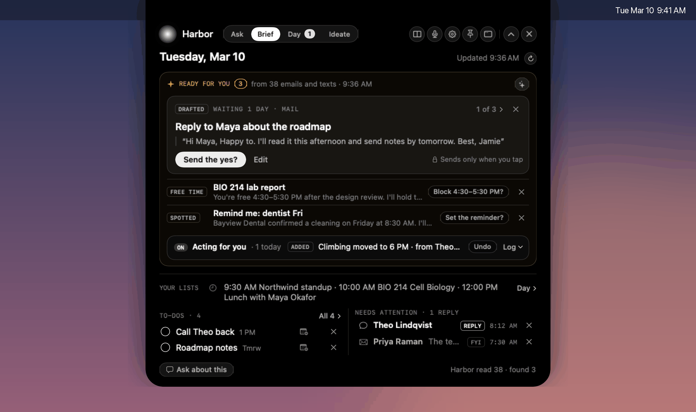
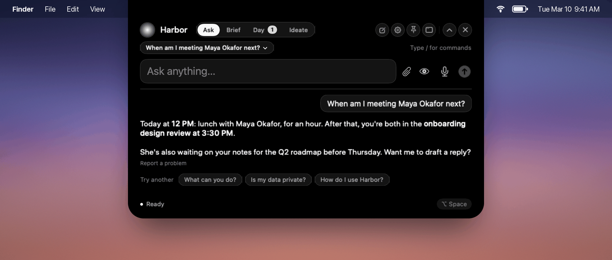
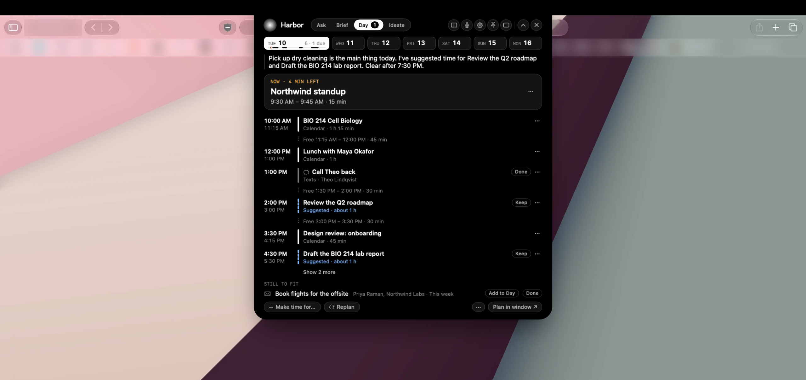
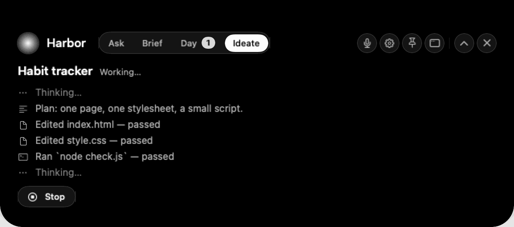
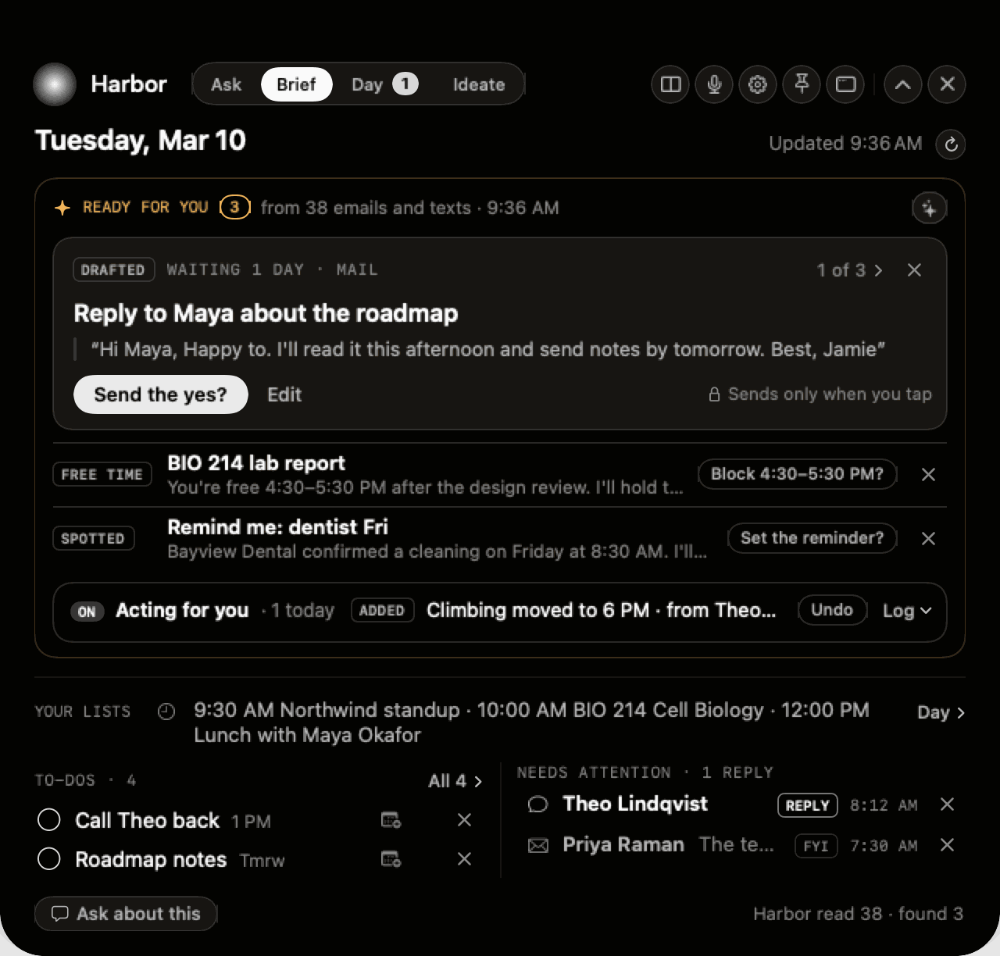

<p align="center">
  
</p>

<p align="center">
  <a href="https://github.com/adjad/Harbor/releases/latest"><b>Download Harbor 0.1.8</b></a>
  · <a href="docs/releases/0.1.8.md">What's new</a>
</p>

<p align="center">
  
</p>

<table>
  <tr>
    <td width="50%"></td>
    <td width="50%"></td>
  </tr>
  <tr>
    <td width="50%"></td>
    <td width="50%"></td>
  </tr>
</table>


Harbor is a private assistant for the Mac. It lives in the notch (or the menu bar on a Mac without
one), reads your mail, messages, calendar and reminders on the Mac, and works out what needs you
today. The AI that does the reading is a local Gemma model running on Apple silicon, so by default
none of that content leaves the computer. Cloud features exist, but each one is opt-in and says what
it sends.

Harbor is a Swift app plus a bundled Python (FastAPI) service. It is Apache-2.0 licensed.

## Features

- **Ask.** Type or speak a request. Harbor looks through mail, messages, calendar, reminders and
  notes, searches the web when it needs to, and can act: draft mail and texts, add events and
  reminders, open apps. Sending, calendar changes and other risky actions wait for your approval.
  Smart Search (Cmd-Shift-F) answers a question about the document on your screen and shows the
  passage it came from.
- **Brief.** What needs you, refreshed a few times a day, in two zones. "Ready for you" is what
  Harbor got ready before you asked: a drafted reply (sent only when you tap Send), deadlines and
  bills found in mail, and anything it added for you, with Undo. "Your lists" holds the rest of
  today's calendar, to-dos from every source, school work and the mail and texts that need you.
- **Day.** A row for the week, the next event as a card (Open in Calendar, and Move… where it can
  be moved), then the rest of the day as a time-ordered agenda of meetings, reminders and open
  time, school deadlines and
  suggested study blocks. A study block stays in Harbor until you tap "Add to calendar" on it; that
  tap books exactly that block in your calendar, and Undo removes it again.
- **Study.** Reads coursework from Canvas pages you have open in your browser (through the
  Accessibility API; Harbor never submits, posts or types on a school site) and from Google Docs
  and Slides you pick in Google Drive. It makes study guides, practice quizzes, short lessons and
  flash cards. Study material is written by a cloud model you connect with your own key. Drive
  slides and PDFs are read one page at a time with Gemini. Brief then shows "Ready for tomorrow"
  with a prepared quiz, Day shows the slides that match a deadline and a "Review (15 min)" item,
  and Ask answers cite the deck and page. "Find materials" on a Canvas course opens the course's
  Modules page, its section lists and up to 100 of its own Pages and Discussions as tabs in your
  browser, closes each tab it opened once it has read it (macOS asks once to let Harbor control
  your browser), and lists the slides, documents, notebooks, PDFs and articles
  they link to. It never opens quizzes, tests, surveys, assignments, submissions or outside tools;
  those are listed as "Can't open" with the reason. A lecture recording is listed by its title and
  link and can be added as a video source, but it is never opened. Nothing is added until you tick
  it.

- **Ideate.** Describe a small project and Harbor builds it in its own folder on this Mac, with the
  built-in engine and one local model, Inkling 2 Mini. It shows each step as it goes and asks before
  anything risky: a command that reaches the network, or a change outside the project folder, always
  gets a card first. It has five starting points (General ideator, UI developer, Debugger, CS student,
  Scripts & data). Ideate is for Apple silicon Macs with more than 16 GB of memory.

Ask, Brief and Day are always in the notch. You can add up to two extra tabs from Meet, Study and
Ideate, in setup or in Settings.

Also in the app: meeting notes, reading files attached to email, and an optional mode where Harbor
adds events and reminders by itself from trusted sources (off until you say yes, with an Undo on
each action). See [CHANGELOG.md](CHANGELOG.md).

## What's new in 0.1.8

- **Ideate,** the new tab above, and a "You" step in setup that suggests extra tabs to suit you.
- **Permissions asked when they are needed.** Setup asks for Calendar, Reminders and Contacts; the
  rest are asked the first time a task needs them.
- **A more accurate Brief.** Things you answered yourself leave it, reply drafts read more of the
  conversation, and a reply card says what it answers.
- **Faster Day and relaunch,** safer sends, cloud requests that mask personal details, and a round of
  security fixes.
- **The built-in engine follows oMLX 0.8.4.**

The full list, and what was and was not tried by hand, is in the
[0.1.8 release notes](docs/releases/0.1.8.md).

## How it uses Gemini and Google APIs

Local Gemma is the default. Ask, Brief and Day run on it with no cloud account. Gemini is used only
where you connect it.

- **Gemini API as a cloud provider.** Harbor can send chat roles to the Gemini API
  (`generativelanguage.googleapis.com`, OpenAI-compatible endpoint) with a key you store in the
  macOS Keychain. Tool calls use function calling. On the Gemini API Harbor keeps each call's
  thought signature and sends it back unchanged on the next request of the same turn, as Google
  requires, then drops it when the turn ends. Signatures are never logged, shown or stored in
  history. Only the exact Gemini origin is accepted for a Gemini key.
- **Gemini for everything.** On Apple silicon, a switch in Settings > Advanced lets the Gemini API
  handle every role. While it is on, pictures and voice recordings also go to Gemini.
- **Study.** Study has its own connector: OpenRouter or the Gemini API, with a key used for Study and
  nothing else. On the Gemini API each kind of material, and page extraction, has its own response
  schema; other providers fall back to JSON mode. Harbor validates the result strictly before it
  shows a quiz, flash cards, a lesson or a guide.
- **Long context.** When the Study model is a Gemini model, Harbor reads more pages per import in
  parallel and sends much larger blocks of source text, so a guide can be written from a whole
  course at once instead of one page at a time. The bounds are in
  [docs/STUDY_TAB.md](docs/STUDY_TAB.md).
- **Gmail, Calendar and Drive through Google sign-in.** One sign-in per Google account asks for
  read-only scopes: Gmail (required), and optionally Calendar, Drive, Docs, Sheets, Slides, Chat,
  Tasks and Contacts. Harbor cannot send, edit or delete anything in your Google account. Brief and
  Day use Gmail and Calendar; Study and Ask use Drive and Docs. See
  [docs/google-cloud-setup.md](docs/google-cloud-setup.md) for the exact scopes and APIs.

## Privacy

What stays on the Mac by default:

- Mail, messages, calendar, reminders, notes, and contacts are read on the Mac and stored in `~/.moe`.
- The chat model, indexes and caches run and live on the Mac. Harbor's own engine is built in.
- Every action Harbor takes is appended to `~/.moe/audit.jsonl`.
- "Report a Problem" builds a file you save yourself. Nothing is uploaded.

What can leave the Mac, only after you turn it on:

- **A cloud chat model.** If you connect one in Settings > Models > Cloud (or run the cloud-only
  build), the prompts, conversation context and tool schemas for the roles you moved go to that
  provider, and it may charge you.
- **Study.** Page text from your courses and the text of Drive files you add are sent to the Study
  model when you ask for material. Without a Study key nothing is sent. Find materials sends the
  title and address (without the query) of each outside link to the Study model, which decides
  whether it is a public reading that is safe to download; Harbor then downloads only those, with
  no cookies or sign-in.
- **Google.** Harbor talks to Google only for accounts you sign in. It reads; it does not write.
- **Web search and research,** when you ask a question that needs them.

Text from mail, web pages, school pages and files is treated as untrusted data, never as
instructions. Some actions always need your approval whatever the setting: sending mail or messages,
calendar changes, AppleScript, permanent deletes, installing a tool.

To turn cloud use off:

- Settings > Models > Cloud: disconnect the provider.
- Study: use Remove key on the Study key card. Keys are in the macOS Keychain, not in files.
- Settings > Google > Disconnect & erase removes the account and everything Harbor read from it.
- `/resetharbor` deletes everything Harbor stored and revokes its permissions.

## Requirements

- Apple silicon (M1 or later) for the local model, 16 GB of memory, about 8 GB free disk for the
  first model download.
- macOS 26.2 or newer to use the built-in engine. On macOS 14 to 26.1, Harbor needs another local
  engine running (oMLX, Ollama, LM Studio or any OpenAI-compatible server on the Mac).
- Building from source needs macOS 14 or newer, Python 3.13 (the version the app ships; the build driver itself starts on Python 3.9 or newer and fetches its own pinned 3.13 runtime), and Apple's Command Line Tools.
- Intel Macs have their own download (`02-Harbor-…-intel.zip`). They cannot run the local model or
  Ideate. A cloud-only mode sends every model role to one OpenAI-compatible server you configure
  while your data, tools and approvals stay on the Mac. See
  [docs/REMOTE_INFERENCE.md](docs/REMOTE_INFERENCE.md).
- Ideate needs the built-in engine, the Inkling 2 Mini download and about 18 GB of free memory when
  a build starts.

## Install and first run

Download the ZIP from the [latest release](https://github.com/adjad/Harbor/releases/latest):
`01-Harbor-…-arm64.zip` for Apple silicon, `02-Harbor-…-intel.zip` for Intel. Or build from source
(next section). Harbor is ad-hoc signed, not notarized, so macOS blocks the
first open:

1. Unzip the build and move `Harbor.app` to Applications.
2. Open it. When macOS says it cannot verify the app, choose Done.
3. Open System Settings > Privacy & Security, scroll down, and choose Open Anyway.

Setup is one window with seven steps you can skip or jump between: Model (it downloads in the
background), Permissions (Calendar, Reminders and Contacts, each optional and asked only when you
click it), Google (optional), About you (optional), You (which extra tabs suit you), How to use (a
picture of the open notch), and Get more (Full Disk Access and automation, all optional, plus a few
questions to try). The first launch of 0.1.8 also does a one-time fresh start of Harbor's own
settings; they are backed up first, and your chats, memory and sign-ins stay. See the
[release notes](docs/releases/0.1.8.md). Harbor then lives in the notch and menu bar. Option-Space
opens Ask, Option-Shift-Space asks by voice, Command-5 opens Study. To quit, right-click the
menu-bar icon.

## Build from source

```bash
python3.13 -m venv .venv
.venv/bin/pip install -r requirements-dev.txt

./scripts/harbor-build doctor      # check the toolchain
./scripts/harbor-build preview     # local build, writes a ZIP under dist/
./scripts/harbor-build test        # Python tests plus Swift contracts
```

`preview` is the fast path: it builds and signs the app and runs structure checks, but skips
Simulation QA, and its output is marked as a preview and is not for distribution.
`./scripts/harbor-build all` runs the full gate on a clean, committed tree. Details are in
[docs/build-release.md](docs/build-release.md) and [TESTING.md](TESTING.md).

To run only the backend while developing, start a local model server, then:

```bash
./scripts/run.sh     # serves http://127.0.0.1:8765
```

Google sign-in in a source build needs your own OAuth client; see
[docs/google-cloud-setup.md](docs/google-cloud-setup.md).

## Project layout

- `app/`: the Swift app (notch UI, settings, setup, permissions).
- `service/`: the Python agent service: tools, assistant layer, memory, inference providers, Study.
- `scripts/` and `build-support/`: the build driver, test and evaluation scripts.
- `tests/`, `test_fixtures/`: Python tests and Swift contract checks.
- `browser-extension/`: Chrome and Safari extension sources.
- `docs/`: architecture notes, the Study tab spec, inference providers, build and release.

## Status and known limits

Harbor is pre-1.0 and changes quickly. Be aware of the following.

- Not notarized. Harbor does not update itself.
- Recent fixes to cloud-key handling are covered by tests that stand in for the Keychain. They have
  not been tried by hand with a real key and real macOS prompts.
- Study is new. Treat it as untested against real school sites and real Drive files
  until you have tried it yourself.
- Several recent features (reading email and Messages attachments, meeting notes, writing-style
  drafts) are noted in the changelog as not yet tried in the running app.
- Google sign-in in the shared test client expires every 7 days and shows an "unverified app"
  warning, because the client has not been through Google's verification.
- Study reads Canvas first; other school sites are not supported.
- Reading the Mac's Mail and Messages needs Full Disk Access for some cases.

Bugs go in [issues](https://github.com/adjad/Harbor/issues). See [CONTRIBUTING.md](CONTRIBUTING.md)
and [SECURITY.md](SECURITY.md).

## License

Apache License 2.0. See [LICENSE](LICENSE).
